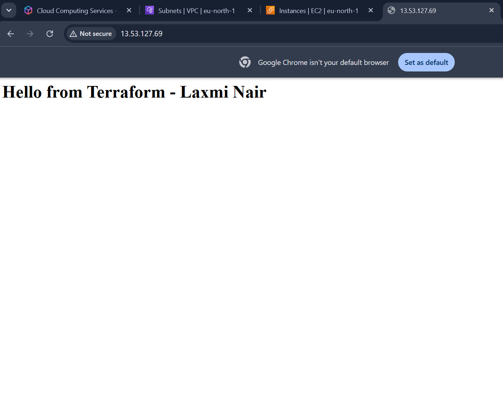

# AWS Infrastructure as Code with Terraform

Provisions a VPC, public subnet, internet gateway, route table, security group,
and an EC2 web server on AWS using Terraform.

## Tech Stack
- Terraform
- AWS (VPC, EC2, Security Groups, Internet Gateway)
- Amazon Linux 2023, Apache (installed via user data)

## What It Creates
- VPC (10.0.0.0/16) with DNS hostnames enabled
- Public subnet (10.0.1.0/24) in eu-north-1a
- Internet gateway and route table (0.0.0.0/0 to the gateway)
- Security group allowing HTTP (port 80) in, all traffic out
- t3.micro EC2 instance that installs Apache on first boot
- Output of the server's public IP

## How to Run
terraform init
terraform plan
terraform apply
terraform destroy

## What I Learned
- Infrastructure as Code and the init, plan, apply, destroy workflow
- How Terraform tracks resources using state
- How resources reference each other (dependency ordering)
- Using a data source to look up the latest AMI
- Using user data to bootstrap a server

## Next Steps
- Restrict SSH access to my IP
- Add variables and outputs
- Containerize an app with Docker and deploy it here